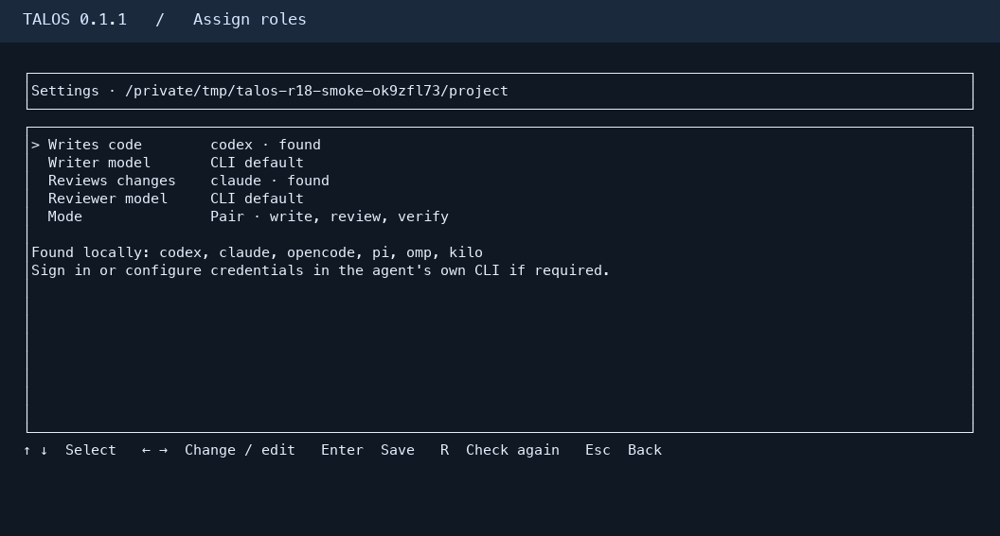
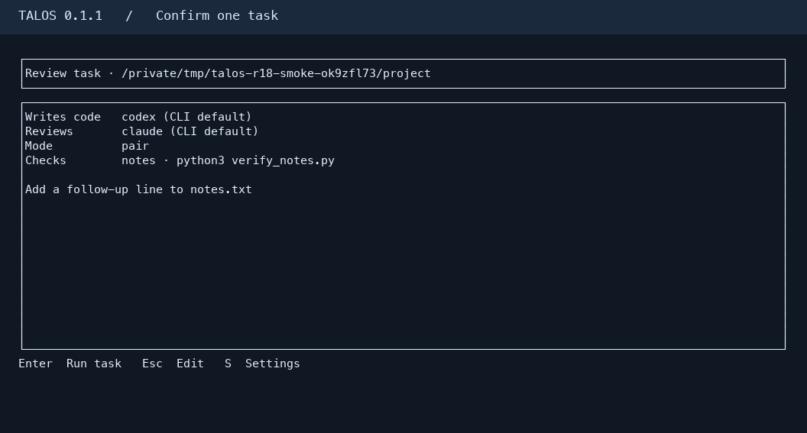

<div align="center">
  <h1>TALOS</h1>
  <p><strong>A local CLI-first orchestrator and terminal cockpit for autonomous AI coding agents</strong></p>
  <p>Coordinate Writer and Critic roles across your installed coding CLIs, verify Git deliverables, and supervise execution locally.</p>
  <p>
    <a href="https://github.com/AVP-Dev/talos/releases/latest"></a>
    <a href="https://github.com/AVP-Dev/talos/actions/workflows/ci.yml"></a>
    <a href="#install"></a>
    <a href="LICENSE"></a>
  </p>
  <p>
    <a href="#overview">Overview</a> ·
    <a href="#interactive-cockpit">Cockpit Walkthrough</a> ·
    <a href="#quick-start">Quick Start</a> ·
    <a href="#orchestration-modes">Orchestration Modes</a> ·
    <a href="#supported-clis">Supported CLIs</a> ·
    <a href="#install">Install</a> ·
    <a href="docs/operator-runbook.md">Operator Guide</a> ·
    <a href="docs/architecture.md">Architecture</a>
  </p>
</div>

---

<div align="center">
  
  <p><sub>TALOS Cockpit running in Agterm — real-time feed, dual-role supervision, and Git verification.</sub></p>
</div>

---

## Overview

**TALOS** is a zero-dependency, local-first supervisor and TUI cockpit for installed AI coding CLIs. It enforces an engineering discipline where **one agent writes** and an **independent critic reviews**, validating every change against real project checks and deterministic Git invariants.

- 🛡️ **Dual-Agent Discipline**: Enforces separate Writer and Critic roles — no single agent grades its own work.
- ⚡ **Adaptive Orchestration (`adaptive`)**: Express triage dynamically routes tasks — lightweight Pair mode for focused single-file fixes, or scalable Team mode for parallel worktrees.
- ⌨️ **Interactive Terminal Cockpit**: Rich, responsive TUI with live progress, input history ($\uparrow/\downarrow$), and an interactive `/` slash command palette.
- 🔌 **Multi-CLI Compatibility**: Out-of-the-box support for 7 popular AI coding CLIs with resilient discovery that tolerates minor CLI updates.
- 🔒 **Deterministic & Offline-First**: Runs strictly in your local environment. Zero external server dependencies, zero message brokers, zero telemetry.

---

## Interactive Cockpit

<details open>
<summary><strong>Watch the Cockpit Walkthrough Demo</strong> (click to collapse)</summary>
<br>
<div align="center">
  
  <p><sub>Native Agterm session: role assignment, preflight checks, Git diff inspection, and session recycling.</sub></p>
</div>
</details>

<br>

<div align="center">
  <table>
    <tr>
      <th align="center" width="50%"><strong>F2 · Settings & Model Selection</strong></th>
      <th align="center" width="50%"><strong>Review & Verification Checks</strong></th>
    </tr>
    <tr>
      <td></td>
      <td></td>
    </tr>
  </table>
</div>

---

## Quick Start

### 1. Launch TALOS
Inside any existing Git repository with at least one commit:
```sh
talos
```
*(If started outside a Git repository, TALOS will prompt you for the project path.)*

### 2. Configure Roles & Mode
- Press **F2** to open **Settings**.
- Assign the **Writer** (writes code) and **Critic** (reviews changes).
- Choose specific models or keep `CLI default`.
- Press **R** at any time to re-scan for newly installed CLIs.
- Press **Enter** to save settings and return to the Cockpit.

### 3. Run a Task
- Type your prompt in the input bar and press **Enter**.
- **Interactive Slash Palette**: Type `/` to open command shortcuts (`/mode`, `/cli`, `/diff`, `/feed`, `/history`, `/help`).
- **Input History**: Use **$\uparrow$** and **$\downarrow$** to navigate previous prompts and commands.
- If uncommitted changes exist, TALOS keeps your draft safe and displays a preflight warning — press **Alt+3** to inspect changes in the **Changes** tab.

### 4. Inspect Results
- **Work** (`Alt+1`): Live feed, active subagent tasks, and final summary.
- **Review** (`Alt+2`): Critic findings, acceptance review, and test results.
- **Changes** (`Alt+3`): Git unified diff of all modifications.
- **Logs** (`Alt+4`): Detailed execution logs and process diagnostics.
- **History** (`F3`): Reopen and inspect past task runs and deliverables.
- **New Session** (`F4` or `/new`): Clear the active view and begin a fresh task context.

---

## Orchestration Modes

Switch modes dynamically inside Cockpit via `/mode <mode>` or run with `--mode <mode>`:

| Mode | Command | Description | Best For |
| :--- | :--- | :--- | :--- |
| **Adaptive** *(Default)* | `/mode adaptive` | Intelligently triages each task: routes small/focused tasks to Pair mode and complex/multi-file tasks to Team mode. | Everyday development, bug fixes, refactoring |
| **Pair** | `/mode pair` | Two agents work in sequence: the Writer implements in the main checkout, and the Critic performs an adversarial review and checks. | Targeted edits, self-contained components |
| **Team** *(Preview)* | `/mode team` | Multi-agent autonomous team: a Writer Lead decomposes tasks, delegates to workers in parallel Git worktrees, and resolves Critic findings. | Large architectural features, multi-file migrations |

> *Tip: Russian aliases `/mode авто`, `/mode пара`, and `/mode команда` are also supported.*

---

## Supported CLIs

TALOS supervises your locally installed AI coding tools without private API locks:

| Agent / CLI | Binary | Roles | Integration Status |
| :--- | :--- | :--- | :--- |
| **Codex** | `codex` | Writer, Critic | Verified & Supported |
| **Claude Code** | `claude` | Writer, Critic | Verified & Supported |
| **Google Antigravity** | `agy` | Writer, Critic | Verified & Supported (tolerates updates $\ge 1.5.0$) |
| **OMP** | `omp` | Writer, Critic | Verified & Supported |
| **Pi** | `pi` | Writer, Critic | Verified & Supported |
| **Kilo** | `kilo` | Writer, Critic | Verified & Supported |
| **OpenCode** | `opencode` | Writer, Critic | Verified & Supported |

Check your local environment anytime with:
```sh
talos doctor
```

---

## Install

### macOS via Homebrew

```sh
brew install AVP-Dev/apps/talos
```

### Prebuilt Release Archives (macOS & Linux)

Download precompiled binaries for your CPU architecture along with their `.sha256` checksums from [GitHub Releases](https://github.com/AVP-Dev/talos/releases/latest).

Verify and install:
```sh
tar -xzf talos-v0.1.1-aarch64-apple-darwin.tar.gz
sudo install -m 755 talos /usr/local/bin/talos
```

### Build from Source

Requirements: Rust 1.80+ stable and Git.
```sh
git clone https://github.com/AVP-Dev/talos.git
cd talos
cargo build --release
sudo install -m 755 target/release/talos /usr/local/bin/talos
```

---

## CLI & Headless Operation

TALOS can also run headlessly in scripts, CI pipelines, or background tmux sessions:

```sh
# Inspect current configuration
talos config show

# Add verification checks (e.g. for Rust or Node)
talos config set checks '[{"id":"test","argv":["cargo","test"],"version_argv":["cargo","--version"],"working_directory":"."}]'

# Enqueue a task with acceptance criteria
talos task add "Add property tests for URL parser" \
  --criteria "All edge cases covered, zero regressions, cargo test passes."

# Run headless supervisor for queued tasks
talos up --auto --task 1
```

---

## Documentation

- 📖 [Operator Runbook](docs/operator-runbook.md) — Setup, configuration, queue management, recovery, and verification checks.
- 🏛️ [Architecture Guide](docs/architecture.md) — Local SQLite state, supervisory process group isolation, and execution stages.
- 📐 [Architecture Decisions (ADRs)](docs/decisions.md) — Accepted architectural records, including ADR-052 (Adaptive Orchestration & Resilient CLI Discovery).
- 🧪 [Acceptance Evidence](docs/acceptance-scenarios.md) — End-to-end verification records across supported agent CLIs.
- 📝 [Release Notes](docs/releases/v0.1.1.md) — Release notes and changelog for v0.1.1.
- 🤝 [Contributing](CONTRIBUTING.md) · [Issue Tracker](https://github.com/AVP-Dev/talos/issues)

---

<div align="center">
  <p>TALOS is an open-source project by <a href="https://avpdev.com/">Aliaksei Patskevich (AVPDev)</a>.</p>
  <p>
    <a href="https://github.com/AVP-Dev">GitHub</a> ·
    <a href="https://t.me/AVP_Dev">Telegram</a> ·
    <a href="LICENSE">Apache 2.0 License</a>
  </p>
</div>
