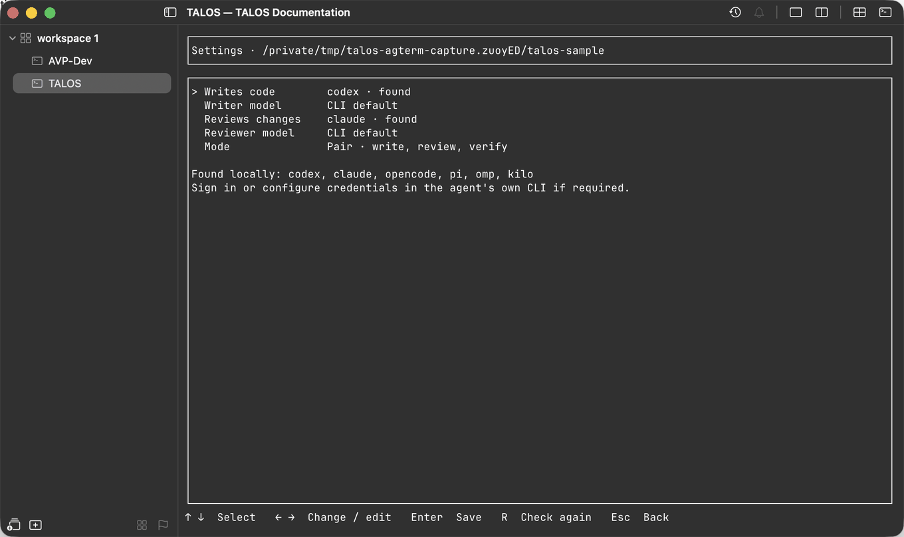

# TALOS

Run a coding task with one agent that writes and another that reviews, then inspect the result in a local terminal cockpit. TALOS coordinates the AI coding CLIs you install separately.

[GitHub Releases](https://github.com/AVP-Dev/talos/releases) · [Operator guide](docs/operator-runbook.md) · [Architecture](docs/architecture.md) · [Website](https://talos.avpdev.com/)


## Install

**macOS with Homebrew**

```sh
brew install AVP-Dev/apps/talos
```

**macOS or Linux with a release archive** — download the archive for your CPU and its matching `.tar.gz.sha256` file from [GitHub Releases](https://github.com/AVP-Dev/talos/releases). Follow the [checksum and install steps](docs/operator-runbook.md#release-archives). Each release lists the binaries it ships.

You need Git, a project with a first commit, and at least one configured coding CLI. Sign in through that CLI if it requires an account. To check your TALOS installation and discover agents, run `talos doctor`. It also reports the executable path if a previous install shadows the new one.

## Run your first task

1. Run `talos` in your project, or enter the project path when prompted.
2. Check **Writes** and **Reviews**. Open `/config` or press **F2** to assign each role and model. Start in **Pair** mode.
3. Describe a change and press **Enter** to review the draft. Check the roles and project checks, then press **Enter** again to run that task. If Git changes block the run, **D** opens the diff and **F5** returns to the draft.
4. Open the result and press **D** to see its saved Git changes. Use `/history` or **F3** to reopen earlier results. Use `/new` or **F4** while idle to start a fresh task with fresh agent conversations and the same project settings.



The screenshots and animation capture the built TALOS terminal interface in a disposable Git project. Deterministic fixture CLIs stand in for Codex and Claude Code, and TALOS runs a real project check. See the [acceptance record](docs/acceptance-scenarios.md) for live provider and platform coverage.

## Choose a mode

| Mode | Workflow |
| --- | --- |
| **Pair** (default) | A Writer makes the change. A separate Critic reviews it. TALOS runs the project's saved checks, when configured, against the approved revision. |
| **Team** (opt-in, preview) | A Writer Lead can split work into parallel Git worktrees, integrate the changes, and respond to Critic findings. Parallel work depends on the plan, configured limits and project conditions. |

TALOS includes adapters for Codex (`codex`), Claude Code (`claude`), Antigravity (`agy`), OMP (`omp`), Pi (`pi`), Kilo (`kilo`), and OpenCode (`opencode`). Provider versions, account setup, permissions and available models vary. Adapter detection confirms local availability, and the [acceptance record](docs/acceptance-scenarios.md) describes which combinations have live evidence.

## Use TALOS from a shell

```sh
talos config show
talos task add "Add a test for empty parser input" --criteria "The test covers empty input and the existing suite passes."
talos task list
talos up --auto --task 1
```

Replace `1` with the ID returned by `talos task add`. Run `talos up --auto` without a task ID when you intend to process the runnable queue.

## Learn more

- [Operator guide](docs/operator-runbook.md) — install, configure checks, operate the queue and recover an interrupted attempt
- [Architecture](docs/architecture.md) — local state, execution stages and boundaries
- [Acceptance evidence](docs/acceptance-scenarios.md) · [Architecture decisions](docs/decisions.md) · [Release notes](docs/releases/v0.1.1.md)
- [Contribute](CONTRIBUTING.md) · [Report an issue](https://github.com/AVP-Dev/talos/issues)

TALOS is a beta project by [Aliaksei Patskevich (AVPDev)](https://avpdev.com/), licensed under [Apache-2.0](LICENSE).
