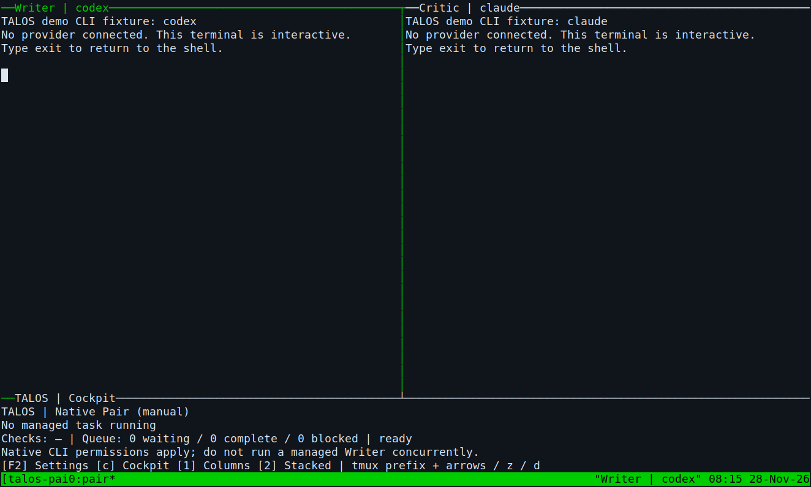
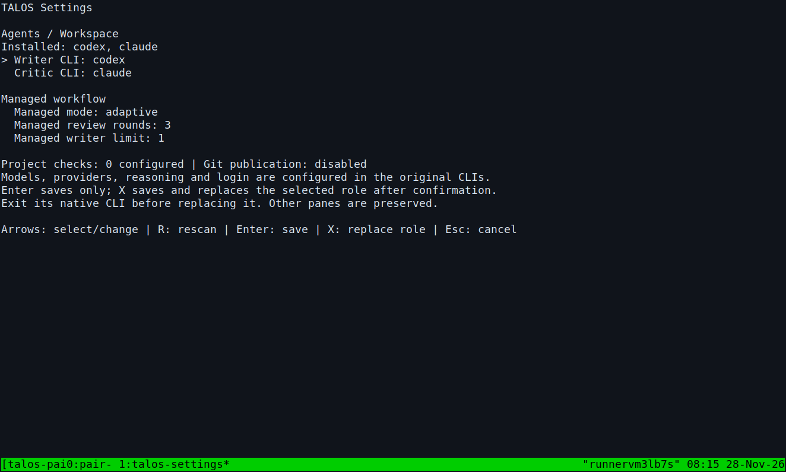

<div align="center">
  <h1>TALOS</h1>
  <p><strong>A persistent terminal workspace for AI coding agents</strong></p>
  <p>Original coding CLIs, a compact control panel, and a separate verified task workflow.</p>
  <p>
    <a href="https://github.com/AVP-Dev/talos/releases/latest"></a>
    <a href="https://github.com/AVP-Dev/talos/actions/workflows/ci.yml"></a>
    <a href="LICENSE"></a>
  </p>
  <p><a href="#native-workspace">Workspace</a> · <a href="#installation">Installation</a> · <a href="#managed-workflow">Managed workflow</a> · <a href="docs/operator-runbook.md">Operator guide</a> · <a href="https://talos.avpdev.com">Website</a></p>
</div>

> **Development preview:** the native workspace described below is available on `master` and in CI preview builds. The published v0.1.1 release remains the previous managed cockpit. Native provider and SSH acceptance are still pending.

## Native workspace

<div align="center">
  
  <p><sub>Actual TALOS development preview running in tmux/xterm. The two test CLI fixtures are interactive but do not connect to a provider.</sub></p>
</div>

TALOS runs the original Writer and Critic CLIs in a persistent tmux session. The agent terminals occupy the main work area; a compact TALOS pane shows recorded task state and provides access to settings and the managed cockpit. Models, reasoning, authentication, and provider permissions belong to the original CLIs.

- **Writer / Critic:** independent interactive terminals.
- **Workspace:** columns or stacked layout; tmux zoom, detach, and reattach.
- **Settings:** select installed CLI roles, rescan, configure managed mode and limits.
- **Persistence:** reconnect to the same workspace without restarting its processes.
- **History and evidence:** open the full managed cockpit when needed.

The native workspace is operator-controlled. It does not infer task completion from CLI output or automatically make the native Critic read-only. Do not run the managed Writer concurrently with manual editing.

## Installation

### Development preview (macOS ARM64 / Linux x64)

Download the platform archive and checksum from a successful [master CI run](https://github.com/AVP-Dev/talos/actions/workflows/ci.yml). These are experimental binaries; they do not replace the stable release automatically. Extract the archive and verify its checksum before running the executable.

### Stable release

```sh
curl -fsSL https://talos.avpdev.com/install.sh | bash
```

On macOS:

```sh
brew install AVP-Dev/apps/talos
```

Other architectures are available in [GitHub Releases](https://github.com/AVP-Dev/talos/releases).

### Build from source

Requirements: Rust 1.100 or newer, Git, installed coding CLIs, and tmux for the native workspace.

```sh
git clone https://github.com/AVP-Dev/talos.git
cd talos
cargo build --release --locked
```

## Quick start

Open TALOS in an existing Git repository with an initial commit:

```sh
talos attach
```

On the first run, select two installed CLI roles. You can also open settings directly with `talos settings`. Enter saves the selections; R rescans installed CLIs. Use the original CLIs to configure their provider settings.

<div align="center">
  
  <p><sub>Native settings window captured from the running development preview.</sub></p>
</div>

| Control | Action |
| --- | --- |
| F2 (status pane) | Open native workspace settings |
| c (status pane) | Open the separate managed cockpit |
| 1 / 2 (status pane) | Columns / stacked layout |
| tmux prefix + arrows | Focus another pane |
| tmux prefix + z | Zoom the focused pane |
| tmux prefix + d | Detach without ending the session |
| `talos attach` | Reconnect from the same project |

The default tmux prefix is Ctrl+B unless configured differently.

### Changing or restarting a role

Exit the selected native CLI first. In settings select the role, press X, and confirm with Y. This replaces only the selected pane. Existing terminal contents in that pane are not preserved. Enter alone saves preferences without restarting any process.

```sh
talos layout stacked
talos layout columns
talos restart-pane writer --confirm
```

## Managed workflow

`talos tui` opens the separate managed task cockpit. It retains the durable task queue, Git revision checks, independent review, project verification, history, and recovery tools. Native CLI sessions are not managed worker attempts.

| Mode | Purpose |
| --- | --- |
| Adaptive | Select Pair or Team for the task |
| Pair | Sequential Writer and Critic review |
| Team (preview) | Parallel worktrees for independent tasks, followed by integration and review |

Configure project-specific checks and inspect evidence in the managed cockpit. Authentication and provider settings are handled by each CLI. Review remote publication and merge decisions explicitly.

## Supported CLIs

Codex (`codex`), Claude Code (`claude`), Antigravity (`agy`), OMP (`omp`), Pi (`pi`), Kilo (`kilo`), and OpenCode (`opencode`).

```sh
talos doctor
```

Installed CLI detection is not proof that a provider is authenticated or that a particular role is fully verified. See the [acceptance record](docs/acceptance-scenarios.md) for the observed evidence.

## Documentation

- [Operator guide](docs/operator-runbook.md)
- [Architecture](docs/architecture.md)
- [Architecture decisions](docs/decisions.md)
- [Acceptance evidence](docs/acceptance-scenarios.md)
- [Current development state](docs/state.md)
- [Contributing](CONTRIBUTING.md) · [Issues](https://github.com/AVP-Dev/talos/issues)

---

TALOS is an open-source project by [Aliaksei Patskevich](https://avpdev.com/). [Apache 2.0 License](LICENSE)

<div align="center">
<sub>AVPdev · Software Development &amp; Automation · <a href="https://avpdev.com/">avpdev.com</a></sub>
</div>
