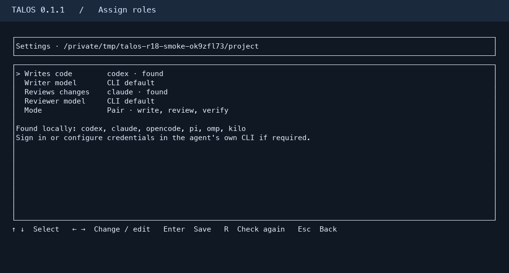

# TALOS Operator Guide

[TALOS](../README.md) · [Architecture](architecture.md) · [Acceptance evidence](acceptance-scenarios.md)

## Install and update

### Homebrew on macOS

```sh
brew install AVP-Dev/apps/talos
brew update && brew upgrade AVP-Dev/apps/talos
```

Run the first command to install and the second when the tap publishes an update. If your shell picks an older copy, use `type -a talos` and `talos doctor` to check the executable search order and active binary.

### Release archives

Download an archive for your platform and the matching `.sha256` file from [GitHub Releases](https://github.com/AVP-Dev/talos/releases). For example, with the Ubuntu-compatible x86-64 archive for `v0.1.1` in your current directory:

```sh
archive=talos-v0.1.1-x86_64-unknown-linux-gnu.tar.gz
shasum -a 256 -c "$archive.sha256" &&
  tar -xzf "$archive" &&
  install -d "$HOME/.local/bin" &&
  install -m 0755 "${archive%.tar.gz}/talos" "$HOME/.local/bin/talos"
"$HOME/.local/bin/talos" --version
```

On Linux, `sha256sum -c "$archive.sha256"` also verifies the file. For macOS or Linux ARM64, use the corresponding asset name shown on the release page. Ensure `$HOME/.local/bin` is on your shell’s `PATH`.

### Installer script or source

For an install script you can inspect before running:

```sh
curl -fsSLo talos-install.sh https://raw.githubusercontent.com/AVP-Dev/talos/v0.1.1/install.sh
less talos-install.sh
bash talos-install.sh
```

The installer verifies the downloaded archive’s checksum and defaults to `$HOME/.local/bin/talos`. From a TALOS source checkout, `cargo install --locked --path .` builds with Rust 1.100 or newer.

## Start a task in the cockpit

Use an existing Git repository with a first commit. Install and configure at least one coding CLI separately. In your project, run `talos` or `talos tui`. If you launch from outside a Git project, the cockpit asks for a project path.

1. **Settings.** Open `/config` or press **F2**. Use arrows to select and change the Writer, Critic, model or mode. Save with **Enter**. **R** rechecks local CLI availability after installation. Authenticate in the selected CLI itself when required.
2. **Draft.** Enter a task with an observable outcome. **Enter** opens the review screen. It shows the assigned roles, selected models, mode and configured check commands. **Esc** returns to editing.
3. **Run.** On the review screen, **Enter** queues and starts that task. A blocked draft remains available. For uncommitted changes, use **D** to inspect the diff and **F5** to return after reviewing your Git changes.
4. **Result.** See the task status, saved report and run details. **D** on a completed result opens its saved Git diff when available. `/history` or **F3** opens the task list. Open a queued task to retry or cancel it.
5. **New session.** Use `/new` or **F4** while idle. It clears the working view and the next run starts fresh agent conversations. Project settings and earlier results remain available.



**Input editing** — use arrow keys, repeated Backspace, multiline paste, **Ctrl+W** or **Alt+Backspace** to delete a word, and **Esc** to clear the input. In the cockpit, `/pause`, `/resume`, `/stop`, `/help` and `/exit` are also available.

## Configure project checks

Set checks before you confirm a task so the review screen can show the commands. From a normal shell, for a Rust project:

```sh
talos config set checks '[{"id":"test","argv":["cargo","test"],"version_argv":["cargo","--version"],"working_directory":"."}]'
talos config show
```

The check list is project-specific and replaces the current list. Use commands relevant to the target repository, such as `pytest` for Python or `npm test` for Node.js. TALOS accepts allowlisted argv arrays and records results against the approved Git revision. If the review screen says no project checks are configured, the run has no configured project test commands.

## Run from a shell

```sh
talos doctor
talos config set writer codex
talos config set critic claude
talos config set mode pair
talos task add "Add a test for empty parser input" --criteria "The test covers empty input and the existing suite passes."
talos task list
talos up --auto --task 1
talos task evidence 1
```

Replace `1` with the actual task ID. Use `talos up --auto` to process the runnable queue, or add `--mode team` to select Team for that run. `talos config set max-writers 2` changes the project’s Writer limit. Use `talos status`, `talos task show <ID>`, and `talos logs <ID>` to inspect work.

## Recover and troubleshoot

| What you see | What to do |
| --- | --- |
| CLI unavailable | Install or configure a CLI, open Settings, and press **R**. Choose a discovered CLI for the affected role. Use `talos doctor` for adapter details. |
| Authentication required | Sign in through the provider’s CLI, then retry the eligible stage or edit the failed task as a new draft. Check the cockpit’s run details for the failing role. |
| Git changes block a new task | Inspect the paths with **D** or `git status --short`. Commit or stash your own work intentionally, then return to the draft. An earlier TALOS version may have left a `.gitignore` change or a root-level report that needs review. |
| A check failed | Inspect `talos task evidence <ID>` and the task details. The verification result is recorded separately from the Critic decision. |
| Queue paused | Use `/resume` in the cockpit or `talos resume` in a shell. After manual changes, inspect and reconcile Git state with `talos resume --reconcile` when needed. |
| Writer stopped or interrupted | Use `/stop` or `talos stop` to request a Writer stop. After an unexpected shutdown, use `talos task recover` to quarantine ambiguous attempts. Inspect the project and use `talos task resolve --help` for explicit operator decisions. |

For a persistent control shell, use `talos attach` with tmux installed. Bare `talos` opens the cockpit directly. Reopening the cockpit reads durable state. When a process disappears or its outcome is uncertain, use recovery to reconcile it.

The project owns `.talos/config.json`, `.talos/state.sqlite3`, and per-task logs and reports. A successful automatic run can save verified changes in a local Git commit. GitHub publication requires project policy and the applicable confirmation path. Inspect local changes and reports before sharing them.

## Maintainer release procedure

Use a stable tag matching the Cargo package version. The [release workflow](../.github/workflows/release.yml) builds four platform archives, smoke-tests each binary, and generates `talos.rb` from the checksums of the release assets. It uses the versioned release notes when present. Apply the generated formula to the [Homebrew tap](https://github.com/AVP-Dev/homebrew-apps) to make the release installable through Homebrew.

For a tap PR, configure `TALOS_HOMEBREW_TAP_TOKEN` with contents and pull request write access limited to the tap. Enable `propose_tap_update` through manual workflow dispatch for one tag, or set `TALOS_AUTO_PROPOSE_TAP` to `true` for future releases. The tap serves the new version after the PR is merged.
